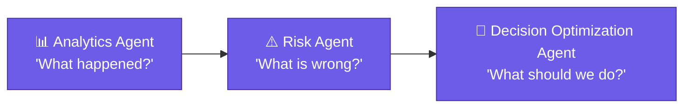
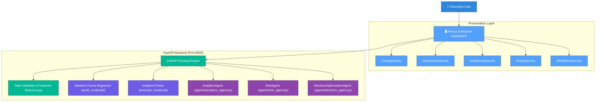

<div align="center">


# 🚀 EVORA — AI Business Intelligence & Decision Optimization System

### Enterprise Vision Optimizing Reasoning Assistant

*Transforming business data into insights, risk awareness, scenario evaluation, and optimized action recommendations.*

<div align="center">


</div>

<br/>

[](https://www.python.org/)
[](https://fastapi.tiangolo.com/)
[](https://nextjs.org/)
[](https://react.dev/)
[](https://scikit-learn.org/)
[](#project-status)

<br/>

### ⚡ From Business Data to Optimized Decisions

</div>

---

> ⚠️ **EVORA does not execute business decisions.**
> It analyzes data, evaluates alternatives, and returns evidence-based recommendations — the final decision always stays with the human user.

---

## 📑 Table of Contents

* [Overview](#overview)
* [Current Implementation vs Planned Features](#current-implementation-vs-planned-features)
* [Core Questions & Agent Architecture](#core-questions--agent-architecture)
* [Machine Learning Services](#machine-learning-services)
* [Risk Analysis & Anomaly Detection](#risk-analysis--anomaly-detection)
* [API Endpoints](#api-endpoints)
* [System Architecture](#system-architecture)
* [Technology Stack](#technology-stack)
* [Project Structure](#project-structure)
* [What-if Analysis & Decision Support](#what-if-analysis--decision-support)
* [Evaluation & Verification](#evaluation--verification)
* [Getting Started](#getting-started)

---

## 🧭 Overview

**EVORA** (Enterprise Vision Optimizing Reasoning Assistant) is a professional AI-powered **Business Intelligence and Decision Support System**.

It analyzes business data, surfaces operational risks, evaluates alternative scenarios, and provides decision-support information while keeping the final decision with the human user.

### Key Architectural Principle: Agent-Centric Dashboard

In EVORA, machine learning models and analytical routines are **underlying capabilities/services**, not disconnected demo widgets:

* **Analytics Agent** → uses business metrics & profit trends to explain *"What happened?"*
* **Risk Agent** → uses anomaly detection (Isolation Forest), risk scoring, and profit predictions (Random Forest) to diagnose *"What is wrong?"*
* **Decision Optimization Agent** *(Architecture prepared)* → uses analytics, risk assessments, and What-If scenario simulations to answer *"What should we do?"*

---

## ⚖️ Current Implementation vs Planned Features

| Capability | Status | Implementation Details |
| :--- | :---: | :--- |
| **CSV Business Data Ingestion** | ✅ **Implemented** | Multipart CSV upload, automated validation of Quantity, Revenue, Expense |
| **Business Metrics Engine** | ✅ **Implemented** | Total/Average Revenue, Expense, Profit, Profit Margin calculation |
| **Profit Prediction** | ✅ **Implemented** | Random Forest Regressor trained on unit metrics (`ml/profit_model.pkl`) |
| **Anomaly Detection** | ✅ **Implemented** | Isolation Forest model for unusual pattern detection (`ml/anomaly_model.pkl`) |
| **Risk Analysis Engine** | ✅ **Implemented** | Multi-factor risk scoring (0-100) & risk tiering (LOW, MEDIUM, HIGH) |
| **What-If Scenario Simulation** | ✅ **Implemented** | Dual-scenario simulation comparing baseline vs target operational shifts |
| **Analytics Agent** | ✅ **Implemented** | Generates synthesized natural language business insights (`agents/analytics_agent.py`) |
| **Risk Agent** | ✅ **Implemented** | Diagnostic reasoning explaining detected risks and anomalies (`agents/risk_agent.py`) |
| **User Authentication** | ✅ **Implemented** | Session persistence supporting Email/Password, Google OAuth, and GitHub OAuth |
| **Decision Optimization Agent** | 🏗️ **Prepared** | Reasoning architecture in `agents/decision_agent.py` awaiting graph orchestration |
| **LangGraph Multi-Agent Flow** | 🔮 *Planned / Future* | Dynamic agent graph orchestration across complex multi-step reasoning |
| **RAG / Knowledge Retrieval** | 🔮 *Planned / Future* | Sentence Transformers + FAISS business document knowledge retrieval (`rag/`) |
| **Excel (.xlsx) Data Upload** | 🔮 *Planned / Future* | Parsing of multi-sheet spreadsheet financial workbooks |
| **Persistent Database Layer** | 🔮 *Planned / Future* | SQLite / PostgreSQL relational storage for historical audit logs |

---

## ❓ Core Questions & Agent Architecture



### 1. 📊 Analytics Agent
* **Core Question:** *"What happened?"*
* **Underlying Capabilities:** Business metrics aggregation, profit margin calculations, and trend analysis.
* **Outputs:** Total revenue, expenses, net profit, profit margin %, and clear synthesized business insights.

### 2. ⚠️ Risk Agent
* **Core Question:** *"What is wrong?"*
* **Underlying Capabilities:** Isolation Forest anomaly detection, Random Forest profit prediction, and rule-based risk scoring.
* **Outputs:** Risk score (0–100), categorical risk level (LOW, MEDIUM, HIGH), anomaly status, and explainable risk reasons.

### 3. 🎯 Decision Optimization Agent *(Architecture Prepared)*
* **Core Question:** *"What should we do?"*
* **Underlying Capabilities:** Synthesizes outputs from Analytics Agent, Risk Agent, and What-If scenario simulations.
* **Outputs:** Evidence-based recommendation action plan with priority levels, preserving human decision authority.

---

## 🤖 Machine Learning Services

EVORA uses lightweight, robust Scikit-Learn models designed for enterprise operational data:

### 1. Profit Prediction — Random Forest
* **Algorithm:** `RandomForestRegressor` (100 estimators)
* **Target:** Net Profit (`Profit = Revenue - Expense`)
* **Features:**
  * `Quantity`
  * `Revenue`
  * `Expense`
  * `Profit_Margin`
  * `Revenue_per_Unit`
  * `Expense_per_Unit`
* **Artifact:** `ml/profit_model.pkl`

### 2. Anomaly Detection — Isolation Forest
* **Algorithm:** `IsolationForest` (200 estimators)
* **Function:** Identifies unusual margin compressions, atypical revenue/expense unit ratios, and statistical outliers.
* **Flag:** Returns `-1` for anomalies, mapped to `anomaly_detected = True` (+60 risk score weighting).
* **Artifact:** `ml/anomaly_model.pkl`

---

## ⚠️ Risk Analysis & Anomaly Detection

EVORA aggregates quantitative indicators into an interpretable 0–100 risk score:

```text
Baseline / Normal pattern:    +10 points
Anomaly detected:             +60 points
Negative profit margin:       +25 points
Profit margin < 10%:          +15 points
Profit margin < 20%:          +5 points
Negative predicted profit:    +15 points
```

### Risk Level Categorization

| Risk Score | Risk Level | Meaning |
| :---: | :---: | :--- |
| **0 – 30** | 🟢 **LOW** | Operations are stable, margins are healthy, and no unusual anomalies are present. |
| **31 – 60** | 🟠 **MEDIUM** | Moderate margin compression or slight operational variance detected. |
| **61 – 100** | 🔴 **HIGH** | Outlier anomaly detected, negative margins, or projected losses requiring executive attention. |

---

## 🔌 API Endpoints

The backend is built with FastAPI and runs on `http://127.0.0.1:8000`.

| Endpoint | Method | Input | Output / Description |
| :--- | :---: | :--- | :--- |
| `/health` | `GET` | *None* | Service health status (`{"status": "healthy"}`) |
| `/upload` | `POST` | `multipart/form-data` (CSV) | Ingests CSV, computes metrics, and runs Random Forest profit prediction |
| `/analytics` | `POST` | `multipart/form-data` (CSV) | Activates Analytics Agent to produce natural language business insights |
| `/ml/predict-profit` | `POST` | JSON: `{Quantity, Revenue, Expense}` | Predicts profit using the trained Random Forest model |
| `/analyze-risk` | `POST` | JSON: `{Quantity, Revenue, Expense}` | Evaluates risk score, risk level, anomaly status, and agent reasons |
| `/what-if` | `POST` | JSON: baseline & target values | Compares current vs hypothetical scenario, computing projected profit delta |

---

## 🏗️ System Architecture



---

## 🛠️ Technology Stack

| Category | Implemented Technologies | Planned / Future Additions |
| :--- | :--- | :--- |
| **Frontend** | Next.js 16 (App Router), React 19, TypeScript, Tailwind CSS, Lucide Icons | Charting library expansion |
| **Backend** | FastAPI, Uvicorn, Python 3.11+, Pydantic | PostgreSQL / SQLite persistence |
| **Data & Feature Engineering** | Pandas, NumPy | Automated schema inference |
| **Machine Learning** | Scikit-Learn (`RandomForestRegressor`, `IsolationForest`), Joblib | Model registry & auto-retraining |
| **AI Agents** | Native Reasoning Agents (`AnalyticsAgent`, `RiskAgent`, `DecisionOptimizationAgent`) | LangGraph dynamic graph orchestration |
| **Auth & Security** | Next.js Client Auth Context, Google/GitHub OAuth session flows, CORS Middleware | JWT / OAuth2 backend validation |

---

## 📁 Project Structure

```text
EVORA/
├── agents/                           # Multi-Agent Reasoning Layer
│   ├── analytics_agent.py            # Analytics Agent ("What happened?")
│   ├── risk_agent.py                 # Risk Agent ("What is wrong?")
│   ├── decision_agent.py             # Decision Optimization Agent ("What should we do?")
│   └── test_analytics_agent.py       # Agent test script
├── backend/                          # FastAPI Backend
│   ├── main.py                       # REST API endpoints & CORS configuration
│   ├── features.py                   # Feature engineering pipeline
│   ├── test_features.py              # Feature engineering test
│   ├── requirements.txt              # Backend dependencies
│   └── pyproject.toml                # Project packaging metadata
├── data/                             # Datasets
│   ├── anomaly_training_data.csv     # Anomaly detector training data
│   └── sample_business_data.csv      # Sample financial data
├── frontend/                         # Next.js App Router Frontend
│   ├── app/
│   │   ├── dashboard/page.tsx        # Modular, agent-centric dashboard (<150 lines)
│   │   ├── login/                    # Login interface (Email, Google, GitHub)
│   │   └── layout.tsx                # App root layout with AuthProvider
│   ├── components/
│   │   ├── dashboard/
│   │   │   ├── CsvUpload.tsx         # CSV ingestion & status component
│   │   │   ├── OverviewCards.tsx     # KPI metrics & ML prediction banner
│   │   │   ├── AnalyticsAgent.tsx    # Analytics Agent reasoning card
│   │   │   ├── RiskAgent.tsx         # Risk Agent meter & anomaly card
│   │   │   ├── WhatIfAnalysis.tsx    # Scenario simulation & comparison
│   │   │   └── types.ts              # Shared TypeScript interfaces
│   │   └── OAuthButtons.tsx          # Google & GitHub OAuth buttons
│   └── lib/
│       ├── api.ts                    # Backend API client
│       └── auth.ts                   # Authentication context & session store
├── ml/                               # Machine Learning Core
│   ├── profit_model.pkl              # Trained Random Forest Regressor
│   ├── anomaly_model.pkl             # Trained Isolation Forest Model
│   ├── train_model.py                # Profit model training script
│   ├── train_anomaly_model.py        # Anomaly model training script
│   └── generate_anomaly_data.py      # Synthetic anomaly data generator
├── tests/                            # Automated Evaluation Suite
│   ├── test_agents_evaluation.py     # Evaluation across 7 business risk scenarios
│   └── test_decision_agent.py        # Decision Optimization Agent tests
├── rag/                              # [Planned] Knowledge retrieval directory
└── README.md                         # Documentation
```

---

## 🔮 What-if Analysis & Decision Support

EVORA allows executive users to simulate operational changes before committing capital:

```text
Baseline Scenario (Current)           Target Scenario (What-If)
Quantity: 100 units                   Quantity: 120 units (+20%)
Revenue:  ₹50,000                     Revenue:  ₹60,000 (+20%)
Expense:  ₹30,000                     Expense:  ₹32,000 (+6.7%)
           ↓                                     ↓
Current Profit: ₹11,790               Target Profit: ₹17,350
           └────────────────┬────────────────────┘
                            ↓
               Net Delta: +₹5,560.00
               Result: Profit may increase
```

---

## 🧪 Evaluation & Verification

The agent suite is validated using automated test suites covering:
* **Normal Business:** Positive profit with healthy profit margin ($\ge 20\%$)
* **Low Risk:** High margins, predictable patterns, risk score $\le 30$
* **Medium Risk:** Moderate margins ($10-20\%$), risk score $31-60$
* **High Risk:** Extreme expense exceeding revenue, risk score $> 60$
* **Anomaly Detected:** Statistical outlier values triggering Isolation Forest
* **Negative Profit:** Revenue $<$ Expense producing loss warnings
* **Positive Profit:** Revenue $>$ Expense confirming profitable operations

To run the verification suite:
```bash
python tests/test_agents_evaluation.py
python tests/test_decision_agent.py
```

---

## 🚀 Getting Started

### 1. Prerequisites
* Python 3.11+
* Node.js 18+ and npm

### 2. Backend Setup
```bash
cd backend
pip install -r requirements.txt
uvicorn main:app --reload --port 8000
```
Backend will be available at `http://127.0.0.1:8000`.

### 3. Frontend Setup
```bash
cd frontend
npm install
npm run dev
```
Open `http://localhost:3000` in your browser.

---

<div align="center">

### 🚀 EVORA — Enterprise Vision Optimizing Reasoning Assistant

<br/>

[](https://github.com/kedar765/EVORA)

<br/><br/>


</div>
