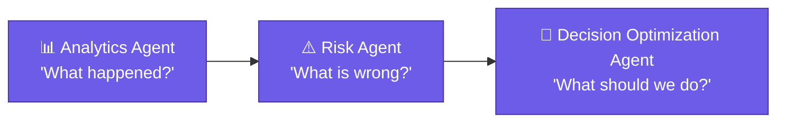
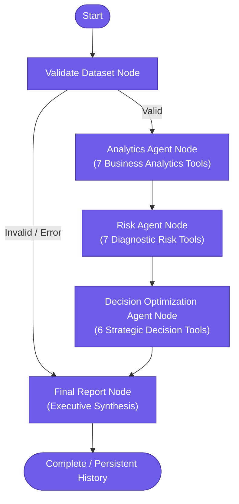
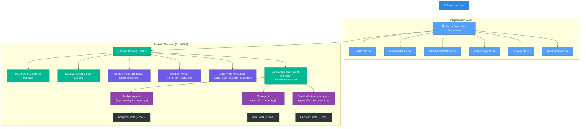

<div align="center">


# 🚀 EVORA — AI Business Intelligence & Decision Optimization System

### Enterprise Vision Optimizing Reasoning Assistant

*Transforming business data into insights, risk awareness, scenario evaluation, and optimized action recommendations.*

<div align="center">


</div>

<br/>

[](https://www.python.org/)
[](https://fastapi.tiangolo.com/)
[](https://nextjs.org/)
[](https://react.dev/)
[](https://scikit-learn.org/)
[](#project-status)

<br/>

### ⚡ From Business Data to Optimized Decisions

</div>

---

> ⚠️ **EVORA does not execute business decisions.**
> It analyzes data, evaluates alternatives, and returns evidence-based recommendations — the final decision always stays with the human user.

---

## 📑 Table of Contents

* [Overview](#overview)
* [Current Implementation vs Planned Features](#current-implementation-vs-planned-features)
* [Core Questions & Agent Architecture](#core-questions--agent-architecture)
* [Machine Learning Services](#machine-learning-services)
* [Risk Analysis & Anomaly Detection](#risk-analysis--anomaly-detection)
* [API Endpoints](#api-endpoints)
* [System Architecture](#system-architecture)
* [Technology Stack](#technology-stack)
* [Project Structure](#project-structure)
* [What-if Analysis & Decision Support](#what-if-analysis--decision-support)
* [Evaluation & Verification](#evaluation--verification)
* [Getting Started](#getting-started)

---

## 🧭 Overview

**EVORA** (Enterprise Vision Optimizing Reasoning Assistant) is a professional AI-powered **Business Intelligence and Decision Support System**.

It analyzes business data, surfaces operational risks, evaluates alternative scenarios, and provides decision-support information while keeping the final decision with the human user.

### Key Architectural Principle: Agent-Centric Dashboard

In EVORA, machine learning models and analytical routines are **underlying capabilities/services**, not disconnected demo widgets:

* **Analytics Agent** → uses business metrics & profit trends to explain *"What happened?"*
* **Risk Agent** → uses anomaly detection (Isolation Forest), risk scoring, and profit predictions (Random Forest) to diagnose *"What is wrong?"*
* **Decision Optimization Agent** *(Architecture prepared)* → uses analytics, risk assessments, and What-If scenario simulations to answer *"What should we do?"*

---

## ⚖️ Current Implementation vs Planned Features

| Capability | Status | Implementation Details |
| :--- | :---: | :--- |
| **CSV Business Data Ingestion** | ✅ **Implemented** | Multipart CSV upload, automated validation of Quantity, Revenue, Expense |
| **Business Metrics Engine** | ✅ **Implemented** | Total/Average Revenue, Expense, Profit, Profit Margin calculation |
| **Profit Prediction** | ✅ **Implemented** | Random Forest Regressor trained on unit metrics (`ml/profit_model.pkl`) |
| **Anomaly Detection** | ✅ **Implemented** | Isolation Forest model for unusual pattern detection (`ml/anomaly_model.pkl`) |
| **Daily Profit Forecasting** | ✅ **Implemented** | Linear Regression daily time-series forecast model (`ml/daily_profit_forecast_model.pkl`) |
| **Risk Analysis Engine** | ✅ **Implemented** | Multi-factor risk scoring (0-100) & risk tiering (LOW, MEDIUM, HIGH) |
| **What-If Scenario Simulation** | ✅ **Implemented** | Dual-scenario simulation comparing baseline vs target operational shifts |
| **Analytics Agent** | ✅ **Implemented** | LangChain agent with 7 analytics tools & backward-compatible `analyze(df)` (`agents/analytics_agent.py`) |
| **Risk Agent** | ✅ **Implemented** | LangChain agent with 7 risk tools & backward-compatible `analyze(...)` (`agents/risk_agent.py`) |
| **Decision Optimization Agent** | ✅ **Implemented** | LangChain agent with 6 decision tools & backward-compatible `recommend(...)` (`agents/decision_agent.py`) |
| **LangGraph Multi-Agent Flow** | ✅ **Implemented** | Cyclical state graph orchestrating validation, analytics, risk, decision optimization, and report synthesis (`workflows/graph.py`) |
| **Persistent Database Layer** | ✅ **Implemented** | SQLite database with user auth, session tokens, dataset ownership registry, and analysis history logs |
| **RAG / Knowledge Retrieval** | 🔮 *Planned / Future* | Sentence Transformers + FAISS business document knowledge retrieval (`rag/`) |
| **Excel (.xlsx) Data Upload** | 🔮 *Planned / Future* | Parsing of multi-sheet spreadsheet financial workbooks |

---

## ❓ Core Questions & Agent Architecture



### 1. 📊 Analytics Agent
* **Core Question:** *"What happened?"*
* **Underlying Capabilities:** Business metrics aggregation, profit margin calculations, time trends, segment comparisons, product performance, and correlation analysis.
* **Outputs:** Total revenue, expenses, net profit, profit margin %, segment breakdowns, and clear synthesized business insights.

### 2. ⚠️ Risk Agent
* **Core Question:** *"What is wrong?"*
* **Underlying Capabilities:** Isolation Forest anomaly detection, Random Forest profit prediction, revenue drop detection, expense growth analysis, loss pattern identification, and risk scoring (0–100 scale).
* **Outputs:** Risk score (0–100), categorical risk level (LOW, MEDIUM, HIGH), anomaly status, and structured risk findings.

### 3. 🎯 Decision Optimization Agent
* **Core Question:** *"What should we do?"*
* **Underlying Capabilities:** Synthesizes outputs from Analytics Agent and Risk Agent, runs What-If scenario simulations, evaluates strategic options, estimates financial impacts, and formulates prioritized action plans.
* **Outputs:** Evidence-based recommendation action plan with priority levels, preserving human decision authority.

---

## 🤖 Machine Learning Services

EVORA uses lightweight, robust Scikit-Learn models designed for enterprise operational data:

### 1. Profit Prediction — Random Forest
* **Algorithm:** `RandomForestRegressor` (100 estimators)
* **Target:** Net Profit (`Profit = Revenue - Expense`)
* **Features:**
  * `Quantity`
  * `Revenue`
  * `Expense`
  * `Profit_Margin`
  * `Revenue_per_Unit`
  * `Expense_per_Unit`
* **Artifact:** `ml/profit_model.pkl`

### 2. Anomaly Detection — Isolation Forest
* **Algorithm:** `IsolationForest` (200 estimators)
* **Function:** Identifies unusual margin compressions, atypical revenue/expense unit ratios, and statistical outliers.
* **Flag:** Returns `-1` for anomalies, mapped to `anomaly_detected = True` (+60 risk score weighting).
* **Artifact:** `ml/anomaly_model.pkl`

---

## ⚠️ Risk Analysis & Anomaly Detection

EVORA aggregates quantitative indicators into an interpretable 0–100 risk score:

```text
Baseline / Normal pattern:    +10 points
Anomaly detected:             +60 points
Negative profit margin:       +25 points
Profit margin < 10%:          +15 points
Profit margin < 20%:          +5 points
Negative predicted profit:    +15 points
```

### Risk Level Categorization

| Risk Score | Risk Level | Meaning |
| :---: | :---: | :--- |
| **0 – 30** | 🟢 **LOW** | Operations are stable, margins are healthy, and no unusual anomalies are present. |
| **31 – 60** | 🟠 **MEDIUM** | Moderate margin compression or slight operational variance detected. |
| **61 – 100** | 🔴 **HIGH** | Outlier anomaly detected, negative margins, or projected losses requiring executive attention. |

---

## 🔌 API Endpoints

The backend is built with FastAPI and runs on `http://127.0.0.1:8000`.

| Endpoint | Method | Input | Output / Description |
| :--- | :---: | :--- | :--- |
| `/health` | `GET` | *None* | Service health status (`{"status": "healthy"}`) |
| `/auth/signup` | `POST` | JSON: `{email, password, full_name}` | Registers new user account with hashed credentials |
| `/auth/login` | `POST` | JSON: `{email, password}` | Authenticates user and returns session token |
| `/auth/me` | `GET` | Header: `Authorization: Bearer <token>` | Returns current authenticated user profile |
| `/upload` | `POST` | `multipart/form-data` (CSV) | Ingests CSV, registers ownership, computes metrics, and runs Random Forest prediction |
| `/analytics` | `POST` | `multipart/form-data` (CSV) | Activates Analytics Agent to produce natural language business insights |
| `/analyze-risk` | `POST` | JSON: `{Quantity, Revenue, Expense}` | Evaluates risk score, risk level, anomaly status, and agent findings |
| `/decision/recommend` | `POST` | JSON: `{metrics, risk_assessment}` | Decision Optimization Agent recommended action plan |
| `/what-if` | `POST` | JSON: baseline & target values | Compares current vs hypothetical scenario, computing projected profit delta |
| `/forecast/next-day` | `POST` | `multipart/form-data` (CSV) | Predicts next day's profit using daily time-series linear regression |
| `/history` | `GET` | Header: `Authorization: Bearer <token>` | Returns user's persistent analysis history logs |
| `/agents/run` | `POST` | JSON: `{dataset_id, user_query}` | **Orchestrated LangGraph Multi-Agent Workflow** (Analytics → Risk → Decision → Executive Report) |

---

## 🔄 LangGraph Multi-Agent Orchestration & Tool Registry

EVORA's flagship capability is a cyclical, state-managed **LangGraph multi-agent pipeline** that executes genuine LangChain tool-calling agents over authenticated user datasets:



### The 20 Specialized Agent Tools

The system provides 20 robust tools implemented across four specialized modules:

#### 1. Centralized Safe Dataset Access Layer (`tools/dataset_tools.py`)
- `load_user_dataset`: Safe CSV loading with path traversal prevention, ownership enforcement, and memory caching.
- `resolve_safe_dataset_path`: Resolves and validates absolute filesystem paths within authorized storage boundaries.
- `identify_semantic_columns`: Robust regex and heuristic mapping for revenue, expense, quantity, date, product, category, and region columns.
- `sanitize_dataframe`: Cleans numerical strings, removes currency symbols, converts dates, and handles nulls gracefully.
- `get_upload_storage_dir`: Resolves active upload storage directory from configuration or environment.

#### 2. Business Analytics Tools (`tools/analytics_tools.py`)
- `get_dataset_profile`: Returns row count, date spans, available dimensions, and detected column mappings.
- `calculate_business_metrics`: Computes total/average revenue, expense, net profit, margin %, and units sold.
- `analyze_time_trends`: Computes monthly or periodic revenue, expense, and profit trajectories.
- `compare_business_segments`: Aggregates and ranks performance by product category or geographic region.
- `analyze_product_performance`: Identifies top revenue generators, most profitable products, and loss-making items.
- `query_business_data`: Filters rows based on column conditions for deep-dive inspection.
- `analyze_relationships`: Evaluates correlation between quantity, expense, and profitability.

#### 3. Diagnostic Risk Tools (`tools/risk_tools.py`)
- `detect_anomalies`: Runs Isolation Forest (`ml/anomaly_model.pkl`) to flag statistical outliers in unit economics.
- `analyze_revenue_drops`: Identifies significant revenue decelerations across consecutive periods.
- `analyze_expense_growth`: Surfaces periods where expense growth outpaced revenue expansion.
- `identify_loss_patterns`: Isolates transactions, products, or segments operating at negative margins.
- `calculate_risk_score`: Deterministic 0–100 multi-factor risk scoring engine with LOW, MEDIUM, HIGH tiering.
- `forecast_business_risks`: Combines ML predictions with margin compression thresholds to forecast near-term risk.
- `explain_risk_records`: Provides detailed record-level explanations for why specific rows were flagged.

#### 4. Strategic Decision Tools (`tools/decision_tools.py`)
- `simulate_business_scenario`: Evaluates hypothetical adjustments in volume, pricing, and cost structures.
- `compare_business_strategies`: Side-by-side evaluation of aggressive growth vs margin defense vs cost reduction.
- `estimate_financial_impact`: Projects expected net profit change and timeline from specific strategic interventions.
- `optimize_resource_allocation`: Recommends optimal budget shifts from low-margin to high-margin operations.
- `generate_action_plan`: Constructs phased, prioritized action items categorized by urgency and impact.
- `evaluate_decision_options`: Multi-criteria decision matrix scoring across ROI, execution risk, and time-to-value.

---

## 🏗️ System Architecture



---

## 🛠️ Technology Stack

| Category | Implemented Technologies |
| :--- | :--- |
| **Frontend** | Next.js 16 (App Router), React 19, TypeScript, Tailwind CSS, Lucide Icons |
| **Backend** | FastAPI, Uvicorn, Python 3.11+, Pydantic v2 |
| **Multi-Agent Orchestration** | LangGraph (StateGraph), LangChain (`create_tool_calling_agent`, `AgentExecutor`) |
| **LLM Tiering** | Gemini Flash → Groq → Deterministic Offline Fallback (`EVORA_SKIP_EXTERNAL_LLM=1`) |
| **Database & Persistence** | SQLite database with user auth, session tokens, dataset ownership registry, and analysis history logs |
| **Data & Feature Engineering** | Pandas, NumPy, robust semantic column detection, sanitization layer |
| **Machine Learning** | Scikit-Learn (`RandomForestRegressor`, `IsolationForest`, `LinearRegression`), Joblib |
| **Auth & Security** | Next.js Client Auth Context, Google/GitHub OAuth flows, PBKDF2 password hashing, Path traversal guards |

---

## 📁 Project Structure

```text
EVORA/
├── agents/                           # Multi-Agent Reasoning Layer
│   ├── analytics_agent.py            # Analytics Agent ("What happened?" + 7 tools)
│   ├── risk_agent.py                 # Risk Agent ("What is wrong?" + 7 tools)
│   └── decision_agent.py             # Decision Optimization Agent ("What should we do?" + 6 tools)
├── backend/                          # FastAPI Backend
│   ├── main.py                       # REST API endpoints & CORS configuration
│   ├── features.py                   # Feature engineering pipeline
│   ├── requirements.txt              # Backend dependencies
│   └── pyproject.toml                # Project packaging metadata
├── data/                             # Datasets
│   ├── anomaly_training_data.csv     # Anomaly detector training data
│   └── sample_business_data.csv      # Sample financial data
├── frontend/                         # Next.js App Router Frontend
│   ├── app/
│   │   ├── dashboard/page.tsx        # Modular dashboard with MultiAgentWorkflow tab
│   │   ├── login/                    # Login interface (Email, Google, GitHub)
│   │   └── layout.tsx                # App root layout with AuthProvider
│   ├── components/
│   │   ├── dashboard/
│   │   │   ├── MultiAgentWorkflow.tsx# Coordinated Multi-Agent Workflow UI component
│   │   │   ├── CsvUpload.tsx         # CSV ingestion & status component
│   │   │   ├── OverviewCards.tsx     # KPI metrics & ML prediction banner
│   │   │   ├── AnalyticsAgent.tsx    # Analytics Agent reasoning card
│   │   │   ├── RiskAgent.tsx         # Risk Agent meter & anomaly card
│   │   │   ├── WhatIfAnalysis.tsx    # Scenario simulation & comparison
│   │   │   └── types.ts              # Shared TypeScript interfaces
│   │   └── OAuthButtons.tsx          # Google & GitHub OAuth buttons
│   └── lib/
│       ├── api.ts                    # Backend API client including runAgentWorkflow
│       └── auth.ts                   # Authentication context & session store
├── ml/                               # Machine Learning Core
│   ├── profit_model.pkl              # Trained Random Forest Regressor
│   ├── anomaly_model.pkl             # Trained Isolation Forest Model
│   ├── daily_profit_forecast_model.pkl # Trained Linear Regression Forecaster
│   ├── train_model.py                # Profit model training script
│   └── train_anomaly_model.py        # Anomaly model training script
├── schemas/                          # Pydantic Output Schemas
│   └── agent_schemas.py              # Strict Pydantic models for agent findings & reports
├── tools/                            # Specialized Tool Layer (20 Tools)
│   ├── dataset_tools.py              # Safe dataset loading & semantic column identification
│   ├── analytics_tools.py            # Business metrics, trends, segments & query tools
│   ├── risk_tools.py                 # Anomaly, drops, loss patterns & risk scoring tools
│   └── decision_tools.py             # Scenario simulations, strategy comparison & action planning
├── workflows/                        # LangGraph Multi-Agent Orchestration
│   ├── state.py                      # EVORAAgentState TypedDict definition
│   ├── nodes.py                      # Validation, Analytics, Risk, Decision & Report nodes
│   └── graph.py                      # StateGraph compilation & conditional routing
├── tests/                            # Automated Evaluation & Test Suite
│   ├── test_tools.py                 # 25 Unit tests for all agent tools
│   ├── test_agent_workflow.py        # 4 Integration tests for LangGraph state graph
│   ├── test_agents_api.py            # 5 End-to-end API tests for POST /agents/run
│   ├── test_agents_evaluation.py     # Evaluation across 7 business risk scenarios
│   ├── test_decision_agent.py        # Legacy Decision Optimization Agent tests
│   ├── test_upload_pipeline.py       # CSV upload & ownership tests
│   └── test_forecast_ml.py           # 14 tests for daily forecasting ML pipeline
└── README.md                         # Project documentation
```

---

## 🔮 What-if Analysis & Decision Support

EVORA allows executive users to simulate operational changes before committing capital:

```text
Baseline Scenario (Current)           Target Scenario (What-If)
Quantity: 100 units                   Quantity: 120 units (+20%)
Revenue:  ₹50,000                     Revenue:  ₹60,000 (+20%)
Expense:  ₹30,000                     Expense:  ₹32,000 (+6.7%)
           ↓                                     ↓
Current Profit: ₹11,790               Target Profit: ₹17,350
           └────────────────┬────────────────────┘
                            ↓
               Net Delta: +₹5,560.00
               Result: Profit may increase
```

---

## 🧪 Evaluation & Verification

The system is rigorously validated through automated unit, integration, and regression suites:

### 1. Multi-Agent System & Tools Test Suite (34 Tests)
```bash
# Run the complete multi-agent test suite (Tools, LangGraph Workflow, and API):
python -m unittest tests/test_tools.py tests/test_agent_workflow.py tests/test_agents_api.py
```
- `tests/test_tools.py` (25/25 passed): Validates all 20 tools across profile, metrics, trends, segments, anomalies, drops, expenses, risk scoring, scenario simulation, strategy comparison, and safe dataset path security.
- `tests/test_agent_workflow.py` (4/4 passed): Validates StateGraph execution, state propagation, error isolation, and deterministic fallback execution.
- `tests/test_agents_api.py` (5/5 passed): Validates `POST /agents/run` authentication, ownership isolation, valid workflow runs, missing dataset rejection, and analysis history persistence.

### 2. Regression & Machine Learning Test Suites
```bash
python -m unittest tests/test_agents_evaluation.py
python -m unittest tests/test_decision_agent.py
python -m unittest tests/test_upload_pipeline.py
python -m unittest tests/test_forecast_ml.py
```

---

## 🚀 Getting Started

### 1. Prerequisites
* Python 3.11+
* Node.js 18+ and npm

### 2. Backend Setup
```bash
cd backend
pip install -r requirements.txt
uvicorn main:app --reload --port 8000
```
Backend will be available at `http://127.0.0.1:8000`.

### 3. Frontend Setup
```bash
cd frontend
npm install
npm run dev
```
Open `http://localhost:3000` in your browser.

---

<div align="center">

### 🚀 EVORA — Enterprise Vision Optimizing Reasoning Assistant

<br/>

[](https://github.com/kedar765/EVORA)

<br/><br/>


</div>
